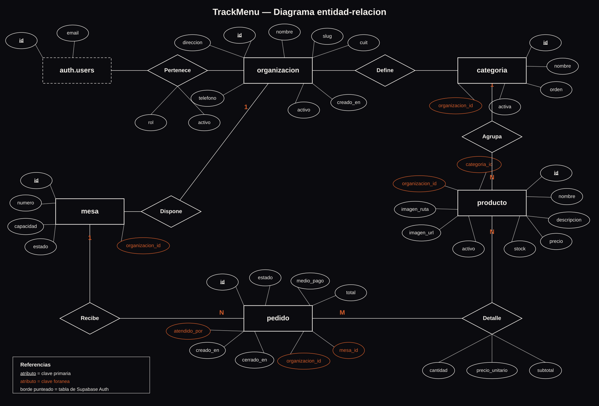

# TrackMenú — Modelo de datos

Documento de diseño de la base de datos: entidades, diagrama entidad-relación, estrategia multi-tenant, roles de usuario, organización del código y diccionario de datos.

Tecnología: **Supabase** (PostgreSQL 15 + Supabase Auth + Supabase Storage).

---

## 1. Qué necesita guardar el sistema

TrackMenú es un SaaS de menú digital y gestión de salón para gastronomía. El comensal escanea el QR de su mesa, ve el menú y arma su pedido; el personal recibe la comanda y administra el estado de las mesas.

De esa operación surge la información a persistir:

- **Quién usa la plataforma**: cada restaurante que contrata el servicio, y las personas que trabajan en él con distintos permisos.
- **Qué se ofrece**: el menú, organizado en secciones, con precio, stock, foto y disponibilidad.
- **Dónde se consume**: las mesas del salón y su estado.
- **Qué se pidió**: la comanda de cada mesa, con su detalle, su estado de preparación y su total.

---

## 2. Entidades

| Entidad | Qué representa | Datos que guarda |
|---|---|---|
| `organizacion` | El restaurante que usa la plataforma. Es el cliente de TrackMenú y la raíz de todo el aislamiento de datos. | Nombre comercial, slug para la URL pública, CUIT, dirección, teléfono, si la cuenta está activa. |
| `usuario_organizacion` | El vínculo entre una persona y un restaurante, con su rol. Es la tabla que convierte a un usuario de Supabase Auth en empleado de una organización. | Usuario, organización, rol, si la membresía sigue vigente. |
| `categoria` | Una sección del menú (Hamburguesas, Bebidas, Postres). Cada organización define las suyas. | Nombre, orden de aparición, si está visible. |
| `producto` | Un ítem del menú. | Nombre, descripción, precio, stock, si está activo, URL y ruta de la imagen. |
| `mesa` | Una mesa física del salón. | Número dentro del local, capacidad, estado (libre, ocupada, reservada). |
| `pedido` | La comanda asociada a una mesa en un momento dado. | Estado de preparación, medio de pago, total, quién la atendió, cuándo se abrió y cerró. |
| `pedido_item` | El detalle del pedido: qué producto y cuántas unidades. | Cantidad, precio unitario al momento del pedido, subtotal calculado, nota de cocina. |

`auth.users` es una tabla que administra Supabase Auth. No se crea ni se modifica desde las migraciones: se la referencia.

---

## 3. Diagrama entidad-relación



El archivo está en [`docs/der/der-trackmenu.svg`](der/der-trackmenu.svg) y se regenera con `node docs/der/generar-der.mjs`, que además avisa si dos elementos del dibujo se superponen.

### Relaciones y cardinalidades

| Relación | Entre | Cardinalidad | Implementación |
|---|---|---|---|
| Pertenece | `auth.users` — `organizacion` | N:M | Tabla asociativa `usuario_organizacion` con atributo `rol`. Una persona puede trabajar en varios locales; un local tiene varios empleados. |
| Define | `organizacion` — `categoria` | 1:N | `categoria.organizacion_id` |
| Agrupa | `categoria` — `producto` | 1:N | `producto.categoria_id` (opcional: un producto puede no tener categoría) |
| Ofrece | `organizacion` — `producto` | 1:N | `producto.organizacion_id` |
| Dispone | `organizacion` — `mesa` | 1:N | `mesa.organizacion_id` |
| Recibe | `mesa` — `pedido` | 1:N | `pedido.mesa_id` |
| Detalle | `pedido` — `producto` | N:M | Tabla asociativa `pedido_item` con atributos `cantidad`, `precio_unitario` y `subtotal` |
| Atiende | `auth.users` — `pedido` | 1:N | `pedido.atendido_por` |

### Decisiones de diseño

- **`pedido_item` guarda `precio_unitario`.** Si mañana sube el precio de la hamburguesa, los pedidos viejos conservan lo que realmente se cobró. Sin esta columna, el historial de ventas se reescribiría solo.
- **`subtotal` es una columna generada** (`cantidad * precio_unitario`), así nunca queda desincronizada, y un trigger recalcula `pedido.total` ante cualquier cambio en el detalle.
- **`organizacion_id` se repite en `producto`, `mesa` y `pedido`** aunque podría deducirse navegando las relaciones. Es desnormalización deliberada: las políticas de seguridad necesitan resolver "¿de qué organización es esta fila?" en una sola comparación, sin subconsultas. Tres triggers verifican que esa redundancia no se contradiga (que la mesa del pedido sea de la misma organización, que la categoría del producto también, y que un ítem no mezcle productos de otro local).
- **Las bajas de producto son lógicas** (`activo = false`), no físicas: un producto discontinuado sigue siendo referenciado por pedidos históricos. Por eso `pedido_item.producto_id` usa `ON DELETE RESTRICT`.

---

## 4. Multi-tenancy: cómo se representa cada cliente

Cada negocio es una fila en `organizacion`. Todo dato operativo cuelga de ella por clave foránea con `ON DELETE CASCADE`: si se da de baja el restaurante, se van sus categorías, productos, mesas y pedidos.

El aislamiento no depende de que el frontend recuerde filtrar por organización, porque eso sería una invitación al error. Se aplica en la base con **Row Level Security**: cada tabla tiene políticas que sólo dejan ver y modificar filas de organizaciones a las que el usuario pertenece. Si el día de mañana alguien escribe una consulta sin filtro, PostgreSQL devuelve únicamente lo que corresponde.

La pregunta "¿este usuario pertenece a esta organización?" se resuelve con tres funciones `SECURITY DEFINER`:

```sql
pertenece_a_organizacion(uuid) -- ¿es miembro activo?
rol_en_organizacion(uuid)      -- ¿con qué rol?
administra_organizacion(uuid)  -- ¿es propietario o encargado?
```

Son `SECURITY DEFINER` por un motivo concreto: si la política de `usuario_organizacion` consultara esa misma tabla directamente, PostgreSQL entraría en recursión infinita al evaluarla. La función corre con los permisos de su dueño y corta el ciclo.

El alta de una organización es el único punto donde cualquier usuario autenticado puede insertar: es el momento en que alguien registra su restaurante. Un trigger `AFTER INSERT` lo convierte automáticamente en `propietario` de lo que acaba de crear, así nadie queda afuera de su propia cuenta por culpa de las políticas.

El menú público es la excepción buscada: el rol `anon` puede leer organizaciones activas, categorías visibles y productos activos, porque el comensal que escanea el QR no tiene cuenta. No puede escribir nada, ni ver mesas ni pedidos.

Las imágenes siguen la misma lógica: en el bucket `productos` cada archivo vive en una carpeta cuyo nombre es el UUID de la organización, y las políticas de Storage verifican esa carpeta contra la membresía del usuario.

---

## 5. Usuarios y roles

**Las contraseñas no se almacenan en ninguna tabla propia.** Las administra Supabase Auth en `auth.users`, con su propio hash y su manejo de sesiones y tokens. El modelo guarda solo la referencia al `id` del usuario.

Los datos del perfil que sí guarda la aplicación son el vínculo laboral y el rol, en `usuario_organizacion`. El nombre se conserva en los metadatos del usuario de Auth, que se completan en el registro.

| Rol | Qué puede hacer |
|---|---|
| `propietario` | Todo dentro de su organización, incluyendo modificar los datos del negocio y gestionar quién trabaja ahí. |
| `encargado` | Administra el menú (categorías y productos), las mesas y las membresías; no puede modificar los datos fiscales de la organización. |
| `mozo` | Lee el menú, toma pedidos, cambia el estado de las mesas y de las comandas. No puede tocar el catálogo. |
| `cocina` | Lee los pedidos y actualiza su estado de preparación. |

Una misma persona puede tener roles distintos en organizaciones distintas: la restricción `UNIQUE (usuario_id, organizacion_id)` permite una membresía por local, no una sola en total.

---

## 6. Estructura de carpetas

```
TrackMenu/
├── frontend/
│   └── src/
│       ├── views/          Pantallas completas asociadas a una ruta (Login, Registro, Productos)
│       ├── view/           Componentes de pantalla heredados del prototipo (Inicio)
│       ├── components/     Piezas reutilizables entre vistas
│       ├── router/         Definición de rutas y guard de autenticación
│       ├── supabase.js     Cliente único de Supabase: punto central de acceso a datos y Auth
│       ├── assets/         Imágenes y hojas de estilo globales
│       └── tests/          Utilidades de prueba (cliente falso de Supabase, setup de Vitest)
│
├── backend/
│   ├── db/
│   │   ├── migrations/     Scripts SQL que construyen el esquema, en orden numérico
│   │   └── seeds/          Datos ficticios de prueba
│   └── src/
│       ├── routes/         Endpoints HTTP de la API Express
│       ├── controllers/    Lógica de cada endpoint
│       ├── config/         Configuración, incluido el cliente de Supabase del servidor
│       └── middlewares/    Manejo de errores y piezas transversales
│
└── docs/
    ├── modelo-de-datos.md  Este documento
    └── der/                Diagrama entidad-relación y su script generador
```

**Dónde se centralizan las operaciones con la base de datos:** en `frontend/src/supabase.js` para la aplicación Vue, y en `backend/src/config/supabase.js` para la API. Ningún componente crea su propia conexión; todos importan esa instancia única.

---

## 7. Scripts SQL

Se ejecutan en orden desde el SQL Editor de Supabase:

| Archivo | Qué hace |
|---|---|
| `010_create_organizacion.sql` | Tablas `organizacion` y `usuario_organizacion`, más las tres funciones de pertenencia y rol. |
| `011_create_catalogo.sql` | Tablas `categoria` y `producto`, con el trigger que valida que la categoría sea de la misma organización. |
| `012_create_operacion.sql` | Tablas `mesa`, `pedido` y `pedido_item`, con los triggers de coherencia y el recálculo del total. |
| `013_enable_rls_multitenant.sql` | Activa RLS y crea todas las políticas, incluidas las de lectura pública del menú. |
| `014_storage_por_organizacion.sql` | Bucket `productos` y políticas de Storage por carpeta de organización. |
| `999_descartar_esquema_legacy.sql` | Elimina las tablas del prototipo (`products`, `tables`, `orders`, `productos`). **Destructivo: ejecutar solo cuando la migración esté verificada.** |

Los seeds están en `backend/db/seeds/010_seed_multitenant.sql` y cargan dos organizaciones completas.

---

## 8. Datos de prueba

El seed crea **Burger House** (CABA) y **Cantina Nonna** (Rosario), cada una con sus categorías, productos, mesas y un pedido con detalle. Sirven para comprobar que el aislamiento funciona: un usuario de Burger House no debe ver ni un solo registro de Cantina Nonna.

Las membresías son el único dato que el seed no puede crear por sí solo, porque requieren usuarios reales en `auth.users`. El script los busca por correo y, si no existen, avisa por consola sin fallar. Para activarlas, crear primero estos usuarios desde Authentication → Add user:

| Correo | Organización | Rol |
|---|---|---|
| `propietario@burger-house.test` | Burger House | propietario |
| `mozo@burger-house.test` | Burger House | mozo |
| `propietario@cantina-nonna.test` | Cantina Nonna | propietario |

---

## 9. Diccionario de datos

### organizacion

| Campo | Tipo | Descripción |
|---|---|---|
| `id` | UUID, PK | Identificador del negocio. |
| `nombre` | TEXT, NOT NULL | Nombre comercial del restaurante. |
| `slug` | TEXT, NOT NULL, UNIQUE | Identificador para URLs públicas. Solo minúsculas, números y guiones, entre 3 y 40 caracteres. |
| `cuit` | TEXT | Identificación fiscal. |
| `direccion` | TEXT | Domicilio del local. |
| `telefono` | TEXT | Teléfono de contacto. |
| `activo` | BOOLEAN, NOT NULL, default `true` | Si la cuenta está habilitada. |
| `creado_en` | TIMESTAMPTZ, NOT NULL, default `now()` | Fecha de alta. |

### usuario_organizacion

| Campo | Tipo | Descripción |
|---|---|---|
| `id` | UUID, PK | Identificador de la membresía. |
| `usuario_id` | UUID, FK → `auth.users(id)`, NOT NULL | Usuario de Supabase Auth. Borrado en cascada. |
| `organizacion_id` | UUID, FK → `organizacion(id)`, NOT NULL | Organización a la que pertenece. Borrado en cascada. |
| `rol` | TEXT, NOT NULL | Uno de `propietario`, `encargado`, `mozo`, `cocina`. |
| `activo` | BOOLEAN, NOT NULL, default `true` | Si la membresía sigue vigente. |
| `creado_en` | TIMESTAMPTZ, NOT NULL, default `now()` | Fecha de incorporación. |

Restricción: `UNIQUE (usuario_id, organizacion_id)`.

### categoria

| Campo | Tipo | Descripción |
|---|---|---|
| `id` | UUID, PK | Identificador de la sección del menú. |
| `organizacion_id` | UUID, FK → `organizacion(id)`, NOT NULL | Dueña de la categoría. |
| `nombre` | TEXT, NOT NULL | Nombre visible (Hamburguesas, Bebidas). |
| `orden` | SMALLINT, NOT NULL, default `0` | Posición en la que se muestra en el menú. |
| `activa` | BOOLEAN, NOT NULL, default `true` | Si se muestra a los comensales. |
| `creado_en` | TIMESTAMPTZ, NOT NULL, default `now()` | Fecha de creación. |

Restricción: `UNIQUE (organizacion_id, nombre)`.

### producto

| Campo | Tipo | Descripción |
|---|---|---|
| `id` | UUID, PK | Identificador del producto. |
| `organizacion_id` | UUID, FK → `organizacion(id)`, NOT NULL | Dueña del producto. |
| `categoria_id` | UUID, FK → `categoria(id)` | Sección del menú. Queda en `NULL` si se borra la categoría. |
| `nombre` | TEXT, NOT NULL | Nombre del plato o bebida. |
| `descripcion` | TEXT | Detalle que ve el comensal. |
| `precio` | NUMERIC(12,2), NOT NULL, `>= 0` | Precio de venta actual. |
| `stock` | INTEGER, NOT NULL, default `0`, `>= 0` | Unidades disponibles. |
| `activo` | BOOLEAN, NOT NULL, default `true` | Si se ofrece en el menú. |
| `imagen_url` | TEXT | URL pública de la foto. |
| `imagen_ruta` | TEXT | Ruta dentro del bucket, necesaria para borrar el archivo. |
| `creado_en` | TIMESTAMPTZ, NOT NULL, default `now()` | Fecha de alta. |

Restricción: `UNIQUE (organizacion_id, nombre)`.

### mesa

| Campo | Tipo | Descripción |
|---|---|---|
| `id` | UUID, PK | Identificador de la mesa. |
| `organizacion_id` | UUID, FK → `organizacion(id)`, NOT NULL | Local al que pertenece. |
| `numero` | SMALLINT, NOT NULL, `> 0` | Número visible en el salón. |
| `capacidad` | SMALLINT, NOT NULL, default `4`, `> 0` | Comensales que admite. |
| `estado` | TEXT, NOT NULL, default `libre` | Uno de `libre`, `ocupada`, `reservada`. |
| `creado_en` | TIMESTAMPTZ, NOT NULL, default `now()` | Fecha de alta. |

Restricción: `UNIQUE (organizacion_id, numero)`.

### pedido

| Campo | Tipo | Descripción |
|---|---|---|
| `id` | UUID, PK | Identificador de la comanda. |
| `organizacion_id` | UUID, FK → `organizacion(id)`, NOT NULL | Local que la registra. |
| `mesa_id` | UUID, FK → `mesa(id)`, NOT NULL | Mesa que hizo el pedido. No se puede borrar una mesa con pedidos. |
| `atendido_por` | UUID, FK → `auth.users(id)` | Empleado que tomó el pedido. Queda en `NULL` si el usuario se elimina. |
| `estado` | TEXT, NOT NULL, default `en_preparacion` | Uno de `en_preparacion`, `listo`, `entregado`, `cancelado`. |
| `medio_pago` | TEXT | Uno de `efectivo`, `tarjeta`, `transferencia`. |
| `total` | NUMERIC(12,2), NOT NULL, default `0`, `>= 0` | Suma de los subtotales. Lo recalcula un trigger. |
| `creado_en` | TIMESTAMPTZ, NOT NULL, default `now()` | Apertura de la comanda. |
| `cerrado_en` | TIMESTAMPTZ | Cierre de la comanda. |

### pedido_item

| Campo | Tipo | Descripción |
|---|---|---|
| `id` | UUID, PK | Identificador de la línea de detalle. |
| `pedido_id` | UUID, FK → `pedido(id)`, NOT NULL | Comanda a la que pertenece. Borrado en cascada. |
| `producto_id` | UUID, FK → `producto(id)`, NOT NULL | Producto pedido. No se puede borrar un producto ya vendido. |
| `cantidad` | SMALLINT, NOT NULL, default `1`, `> 0` | Unidades pedidas. |
| `precio_unitario` | NUMERIC(12,2), NOT NULL, `>= 0` | Precio al momento del pedido, congelado. |
| `subtotal` | NUMERIC(12,2), generada | `cantidad * precio_unitario`, calculada por la base. |
| `nota` | TEXT | Aclaración para cocina (sin cebolla, punto de cocción). |

Restricción: `UNIQUE (pedido_id, producto_id)`.
